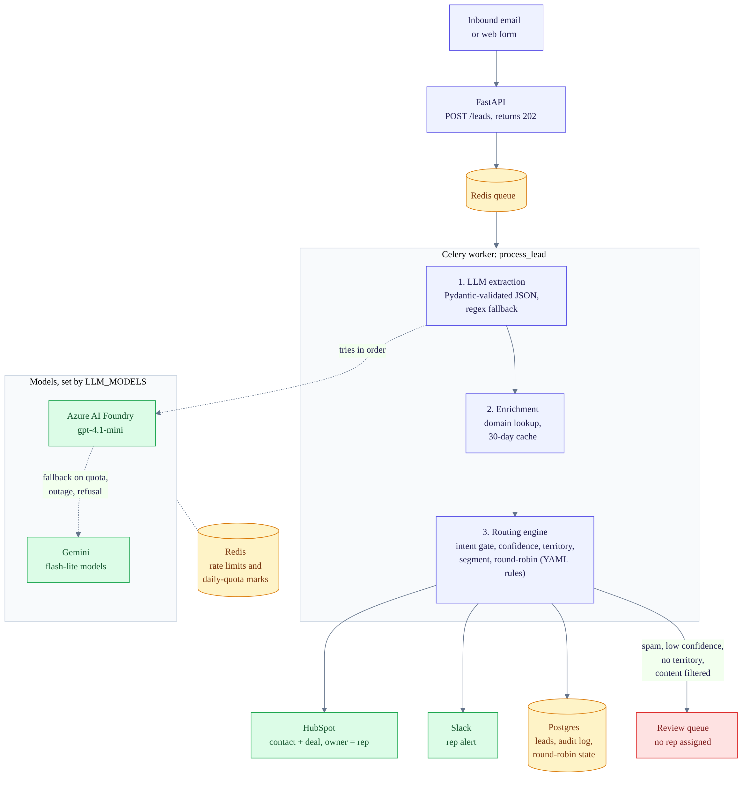
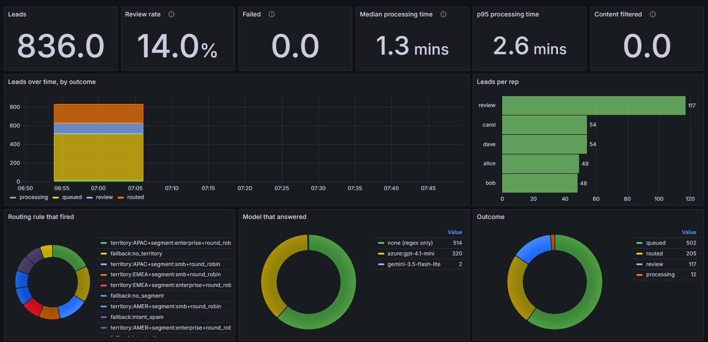

# Switchboard

An automated inbound lead routing service. It ingests sales inquiries (email or web form), extracts structured data with an LLM, enriches the lead with company info, applies territory and size rules with round-robin assignment, writes the result to HubSpot, and alerts the assigned rep in Slack. Every routing decision is stored in an audit log.

Everything runs in Docker. You do not need Python installed locally.

## Features

- **Ingestion:** `POST /leads` accepts `{from, subject, body}`; processing happens off the request path in a Celery worker
- **LLM extraction:** name, company, role, intent, urgency, country and size pulled into a validated JSON schema, with a regex fallback for email, domain and phone
- **Model fallback:** an ordered list of models (Azure AI Foundry and/or Gemini); a model that runs out of daily quota is skipped until it resets, and the same email is retried on the next one
- **Enrichment:** company size and location from the email domain (cached for 30 days; mock provider included)
- **Routing engine:** intent gate, territory, company-size segment, then round-robin within a team, with rules defined in YAML
- **Human fallback:** spam, "other", and low-confidence leads go to a review queue instead of being guessed at
- **CRM sync:** idempotent create/update of HubSpot contacts and deals (no duplicates on repeat emails)
- **Notifications:** Slack message to the assigned rep with a lead summary
- **Audit log:** every decision is stored with the rule that fired, a confidence score, and the model that answered
- **Evaluation:** labeled datasets with a dev/test split, extraction and routing accuracy, per-model and per-batch-size reports

## Architecture



The diagram source is `docs/architecture.mmd` (Mermaid); edit it and re-render to update the image.

## Tech Stack

| Layer | Choice |
|---|---|
| API | Python 3.12, FastAPI |
| Queue / workers | Redis, Celery |
| Validation | Pydantic |
| Database | PostgreSQL, SQLAlchemy, Alembic |
| LLM | Azure AI Foundry (e.g. gpt-4.1-mini) and Google Gemini, with ordered fallback |
| CRM | HubSpot |
| Alerts | Slack incoming webhooks |
| Packaging | Docker, Docker Compose |
| Testing / CI | pytest, ruff, GitHub Actions |

## Getting Started

### Prerequisites

- Docker and Docker Compose
- At least one LLM: an Azure AI Foundry deployment, or a Gemini API key
- A HubSpot service key (optional; use `CRM_MODE=mock` to skip)
- A Slack incoming webhook URL (optional; without it alerts are only logged)

### Setup

```bash
git clone <your-repo-url> switchboard
cd switchboard
cp .env.example .env
# fill in the values in .env
docker compose up -d --build
```

The API is then available at `http://localhost:8000`, with interactive docs at `http://localhost:8000/docs`. Migrations run automatically when the API starts.

### Try it

```bash
# send a sample lead through the whole pipeline and print the result
docker compose exec api python scripts/smoke.py

# list recent leads
docker compose exec api python scripts/smoke.py --list

# load 12 varied sample leads (SMB, enterprise, no territory, spam, duplicate, gibberish)
# and print who each one was assigned to
docker compose exec api python scripts/seed.py
```

`seed.py` refuses to run with `CRM_MODE=hubspot`, because every routed lead would create a real HubSpot contact and deal. Use `CRM_MODE=mock` for demos (or pass `--allow-hubspot`). To seed from a dataset instead: `docker compose exec api python scripts/seed.py --file eval/dataset.jsonl --limit 20`.

Or with curl:

```bash
curl -X POST http://localhost:8000/leads \
  -H "Content-Type: application/json" \
  -d '{
    "from": "jane.doe@acme.com",
    "subject": "Pricing for 200 seats",
    "body": "Hi, we are a logistics company in Singapore looking for pricing on 200 seats."
  }'
```

The lead is parsed, enriched, assigned to a rep, synced to HubSpot, and announced in Slack. The decision, including `llm_model` (which model answered), appears under `GET /leads/{id}`.

## Configuration

Environment variables (see `.env.example`):

| Variable | Description |
|---|---|
| `LLM_MODELS` | Ordered, comma-separated list. Plain names are Gemini models, `azure:<deployment>` is Azure. Empty means use `GEMINI_MODELS` |
| `GEMINI_MODELS` | Gemini models tried in order (default `gemini-3.5-flash-lite,gemini-3.1-flash-lite`) |
| `GEMINI_API_KEY` | Gemini API key |
| `GEMINI_RPM` | Requests per minute, per Gemini model (default `15`) |
| `GEMINI_BATCH_SIZE` | Eval only: emails per request when Gemini is first in line (default `20`) |
| `AZURE_BATCH_SIZE` | Eval only: emails per request when Azure is first in line (default `20`; `1` = no batching) |
| `AZURE_ENDPOINT` | Resource endpoint ending in `/openai/v1/` |
| `AZURE_API_KEY` | Key for the Azure resource |
| `AZURE_RPM` | Requests per minute, per Azure deployment (default `60`) |
| `DATABASE_URL` | Postgres connection string |
| `REDIS_URL` | Redis connection string |
| `CRM_MODE` | `hubspot` or `mock` |
| `HUBSPOT_TOKEN` | HubSpot service key |
| `HUBSPOT_PORTAL_ID` | Portal id, used for deal links in Slack |
| `HUBSPOT_DEFAULT_OWNER_ID` / `HUBSPOT_OWNER_IDS` | Deal owner ids (`alice=123,bob=456` for per-rep) |
| `SLACK_WEBHOOK_URL` | Slack incoming webhook |
| `ENRICHMENT_PROVIDER` | `mock` (Apollo/Hunter not implemented yet) |
| `LOG_FORMAT` / `LOG_LEVEL` | `json` (default) or `text`; log level (default `INFO`) |
| `GRAFANA_ADMIN_PASSWORD` | Admin password for the optional Grafana service (default `admin`) |
| `PROFILE_PATH` | Profile to run (default `config/profiles/sales.yaml`; see Profiles below) |
| `ROUTING_SMB_REPS` / `ROUTING_ENTERPRISE_REPS` | Comma-separated rep names per team, e.g. `smb-apac-1,smb-emea-1`. Empty uses the profile's own list |
| `ROUTING_TEAM_<NAME>_REPS` | Same for any team in any profile, e.g. `ROUTING_TEAM_BILLING_REPS=grace,heidi` |
| `ROUTING_ENTERPRISE_MIN_EMPLOYEES` | Headcount at which a lead counts as enterprise (default `500`) |
| `ROUTING_TERRITORIES` | `REGION=CC,CC;REGION=CC` e.g. `APAC=SG,PH,AU,JP;EMEA=GB,DE,FR;AMER=US,CA,BR` |
| `ROUTING_FALLBACK_QUEUE` | Name of the review queue (default `review`) |
| `CONFIDENCE_THRESHOLD` | Below this, leads go to the review queue (default `0.7`) |

### Choosing models

```dotenv
# Azure first, Gemini as backup
LLM_MODELS=azure:gpt-4.1-mini,gemini-3.5-flash-lite,gemini-3.1-flash-lite

# Gemini only
LLM_MODELS=gemini-3.5-flash-lite,gemini-3.1-flash-lite
```

How failures are handled:

- **Daily-quota 429:** the model is marked exhausted in Redis until the reset time in the error, and every worker skips it
- **503 / 5xx:** short backoff and retry, then the next model (the failing model is skipped for one minute)
- **Per-minute 429:** wait the suggested time and retry
- **All models exhausted:** the lead is retried later by Celery; an eval pauses and keeps its progress

After editing `.env`, recreate the containers:

```bash
docker compose up -d --force-recreate api worker
```

Find HubSpot owner ids with `docker compose exec api python scripts/list_owners.py`.

### Profiles

A profile is one YAML file that says what the AI reads and how items are routed, so Switchboard is not limited to sales. One profile is active at a time, chosen with `PROFILE_PATH` in `.env`. Two ship with the repo:

| File | What it does |
|---|---|
| `config/profiles/sales.yaml` | Default. Sales inquiries: territory and company size, round-robin, HubSpot and Slack |
| `config/profiles/support.yaml` | Example. Support-ticket triage: outage, bug, billing, and so on, routed by category, severity and plan; Slack only |

To switch, set `PROFILE_PATH=config/profiles/support.yaml` in `.env` and recreate the containers (`docker compose up -d --force-recreate api worker`). To make your own, copy one and edit it. A bad profile stops startup with a message that names the rule or field that is wrong.

```yaml
name: support
item_name: ticket            # used in the Slack message
subject: inbound customer support emails   # "You extract data from ..." in the prompt
categories: [outage, bug, billing, account, how_to, feature_request, spam, other]
default_category: other
category_help:               # shown to the AI so it knows what each category means
  spam: unsolicited marketing, phishing, or gibberish
fields:                      # what the AI extracts (string, integer, number, boolean, choice)
  summary: {type: string, description: one short sentence describing the problem}
  severity: {type: choice, values: [low, medium, high], default: medium}
  plan: {type: choice, values: [free, pro, enterprise]}
derived:                     # computed from extracted fields, usable in rules (map or bands)
  region: {from: country, map: {APAC: [SG, JP]}}
teams:
  oncall: {reps: [erin, frank]}
rules:                       # in order; the first match wins
  - when: {intent: outage}
    to: {team: oncall}       # or {queue: some-queue}; {queue: fallback} = fallback_queue
    label: "outage->oncall"  # recorded in the audit log; {field} is filled in
fallback_queue: triage
enrichment: {fill: [country, employee_count]}   # fill from the domain lookup when the email lacks them
integrations: {crm: false, slack: true, title_field: summary, summary_fields: [intent, severity]}
```

Conditions in `when` are all required. `intent: [a, b]` means "is one of", `severity: high` means equals, and `{gte: 500}` style operators are `eq in not_in gt gte lt lte contains exists`. `intent`, `email`, `phone`, `domain` and `confidence` exist in every profile.

Checks that always run first, in every profile: a message every model refused goes to the fallback queue (`fallback:content_filtered`), then anything under `CONFIDENCE_THRESHOLD` (`fallback:low_confidence`). If no rule matches, it goes to the fallback queue as `fallback:no_match`; a rule that names a team that does not exist gives `fallback:unknown_team:<name>`. In the sales profile the spam/other gate is its first rule, so a low-confidence spam email is now labelled `low_confidence` instead of `intent_spam` (it lands in review either way).

The `ROUTING_*` variables in `.env` override the matching values of the active profile, so rep names can change without editing the YAML. Rep names are free text, so use descriptive ones. If you map reps to HubSpot owners with `HUBSPOT_OWNER_IDS`, the keys must match these names exactly.

Evaluate a profile with its own labeled set: `docker compose run --rm api python eval/run_eval.py --file support_triage.jsonl --profile config/profiles/support.yaml`. Every key under `expected` except `team` is scored as an extracted field; `team` is scored as the routing outcome. `eval/support_triage.jsonl` is a small hand-written set (20 rows) for the support profile.

The sales profile's order: spam and other go to review, then territory, then segment, then round-robin within the matching team.

## Commands

All commands run through Docker from the project folder. Use `exec` for things that talk to the running API, and `run --rm` for one-off jobs.

### Run and inspect

```bash
docker compose up -d --build                      # start everything
docker compose up -d --build --force-recreate api worker   # after changing .env or code
docker compose ps                                 # what is running
docker compose logs api --tail 50                 # API log
docker compose logs worker --tail 50              # worker log (JSON, one line per event)
docker compose down                               # stop (add -v to wipe the database)
docker compose exec api alembic upgrade head      # run migrations by hand
docker compose exec api alembic current           # show migration version
```

### Test and lint

```bash
docker compose run --rm api python -m pytest -q
docker compose run --rm api ruff check app tests eval scripts
```

### Build the datasets

All eval files live in `eval/`.

| File | What it is |
|---|---|
| `dataset.jsonl` | 138 clean synthetic emails (regenerate with `scripts/make_dataset.py`) |
| `messy.jsonl` | 38 hand-written hard cases; cannot be regenerated, keep it |
| `synthetic_dataset.jsonl` | the large raw synthetic set you supply |
| `synthetic_dev.jsonl` / `synthetic_test.jsonl` | generated dev and held-out test split |

```bash
# regenerate the clean 138-row set
docker compose run --rm api python scripts/make_dataset.py

# split the large raw set into a deduped, seeded dev/test pair
docker compose run --rm api python scripts/prep_synthetic.py --n 1000

# options: total rows, seed, test share, per-company cap, input file
docker compose run --rm api python scripts/prep_synthetic.py --n 200 --seed 3 --test-frac 0.3 --max-per-company 5
docker compose run --rm api python scripts/prep_synthetic.py --input eval/my_file.jsonl
```

`prep_synthetic.py` drops empty and duplicate emails, caps how often one company appears, samples stratified by expected team, and writes `synthetic_dev.jsonl` and `synthetic_test.jsonl` with the same team mix. Tune on dev only; run test once at the end.

### Run the evaluation

```bash
# default: uses LLM_MODELS from .env
docker compose run --rm api python eval/run_eval.py --file synthetic_dev.jsonl

# the clean and hand-written sets
docker compose run --rm api python eval/run_eval.py
docker compose run --rm api python eval/run_eval.py --file messy.jsonl

# quick check on the first N rows
docker compose run --rm api python eval/run_eval.py --file synthetic_dev.jsonl --limit 30
```

**Pick the model for one run** with `--model` (comma-separated, tried in order, overrides `LLM_MODELS`):

```bash
docker compose run --rm api python eval/run_eval.py --file synthetic_dev.jsonl --model azure:gpt-4.1-mini
docker compose run --rm api python eval/run_eval.py --file synthetic_dev.jsonl --model gemini-3.5-flash-lite
docker compose run --rm api python eval/run_eval.py --file synthetic_dev.jsonl --model gemini-3.1-flash-lite
docker compose run --rm api python eval/run_eval.py --file synthetic_dev.jsonl --model azure:gpt-4.1-mini,gemini-3.5-flash-lite
```

**Batching** (several emails per request) cuts the number of requests: Gemini's free tier caps requests per day, and Azure is faster in batches. It is automatic by default: `GEMINI_BATCH_SIZE` (20) when Gemini is the model answering, `AZURE_BATCH_SIZE` (20) when Azure is. If Azure fails mid-run and Gemini takes over, later requests start batching by themselves. Force a size with `--batch`:

```bash
docker compose run --rm api python eval/run_eval.py --file synthetic_dev.jsonl --model gemini-3.5-flash-lite --batch 20
docker compose run --rm api python eval/run_eval.py --file synthetic_dev.jsonl --model gemini-3.5-flash-lite --batch 50
docker compose run --rm api python eval/run_eval.py --file synthetic_dev.jsonl --model gemini-3.5-flash-lite --batch 1   # no batching
```

Larger batches use fewer requests but can lower accuracy. Compare sizes on the same rows (`--limit 100`) and keep the largest one whose numbers match `--batch 1`. Emails the model skips or garbles in a batch are re-done on their own.

**Resume:** extraction answers are cached in `eval/.cache/` per dataset, model list and batch size. If a run crashes or every model runs out of quota it exits with a pause message; run the same command again to continue. Delete `eval/.cache/` to force a fresh run.

**Results:** written to `eval/results*.md`. Runs that use `--model` or `--batch` add the model and batch size to the file name, so different runs do not overwrite each other. Each file reports extraction accuracy per field, routing accuracy (also without the two mock-enrichment domains, whose labels conflict with the mock table), a confusion matrix, the miss lists, and how many emails each model answered.

Reporting rules: tune on dev only, report the held-out test number with the model that produced it, and call everything synthetic or hand-written unless real data is added.

## Observability

**Dashboard (optional).** Grafana reads Postgres directly and ships with a provisioned dashboard, so it works from a fresh clone with no clicking:

```bash
docker compose --profile observability up -d
```

Open `http://localhost:3000` (view-only without logging in; edit with user `admin` and `GRAFANA_ADMIN_PASSWORD`, default `admin`). Panels: leads, review rate, failures, content-filtered count, median and p95 processing time, leads over time by outcome, leads per rep, routing rule that fired, model that answered, processing time over time, and a table of the latest review-queue leads. The time picker applies to every panel. Plain `docker compose up` does not start Grafana.



*Demo data from the synthetic eval set, captured mid-run, so some leads are still queued. The review rate is high because that set deliberately includes spam and unroutable emails.*

**Metrics.** `GET /metrics` returns Prometheus-format text computed from Postgres on each scrape (leads by status, decisions by rule and by rep, leads by answering model, p50/p95 processing seconds), so the numbers are correct across the API, every worker, and restarts:

```bash
curl http://localhost:8000/metrics
```

**Logs.** API and worker write one JSON object per line to stdout. Each processed lead logs `lead_id`, `outcome`, `rule`, `rep`, `llm_model`, `confidence` and `duration_ms`. Set `LOG_FORMAT=text` for plain text while developing, and `LOG_LEVEL` to change verbosity.

```bash
docker compose logs worker --tail 20
```

## Project Structure

```
switchboard/
├── app/
│   ├── api/            # FastAPI routes
│   ├── workers/        # Celery tasks
│   ├── extraction/     # LLM calls, fallback, batching, rate limits
│   ├── enrichment/     # Provider clients and cache
│   ├── routing/        # Generic rule engine and round-robin
│   ├── integrations/   # HubSpot and Slack clients
│   ├── db/             # Models
│   └── main.py
├── config/
│   └── profiles/       # sales.yaml, support.yaml (pick one with PROFILE_PATH)
├── docs/               # architecture diagram (png + Mermaid source)
├── grafana/            # provisioned datasource and dashboard (optional profile)
├── eval/               # datasets, run_eval.py, results, .cache/
├── migrations/         # Alembic
├── scripts/            # smoke.py, seed.py, list_owners.py, prep_synthetic.py, make_dataset.py
├── tests/
├── docker-compose.yml
├── Dockerfile
├── .env.example
└── README.md
```

## Design Notes

- **Idempotency:** contacts are matched on email before creating anything in HubSpot, so repeat inquiries update rather than duplicate.
- **Validation:** LLM output must pass the Pydantic schema; failures are retried once, then the regex fallback fills what it can and the lead goes to review.
- **Spam and prompt injection:** the model only extracts fields; routing is decided by code. Spam and "other" intents never reach a rep, whatever the email says.
- **Round-robin state** is kept in Postgres with a row lock, so it survives restarts and works across multiple workers.
- **Quota handling:** per-model rate limiters and exhaustion marks live in Redis, shared by every worker.

## License

MIT
